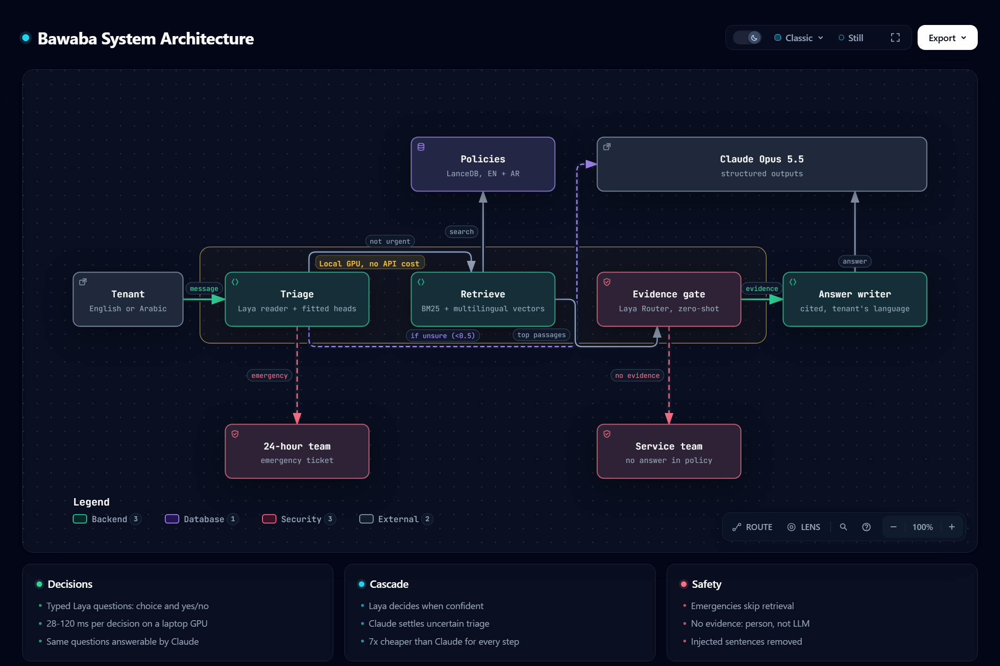
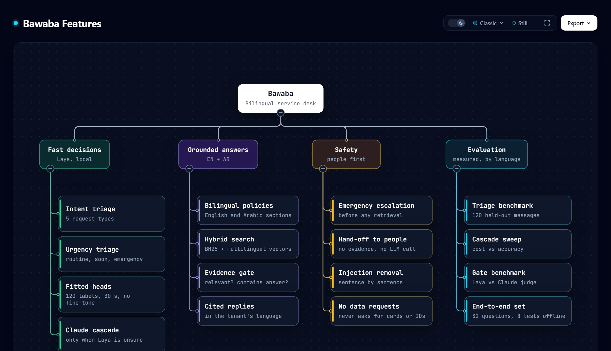
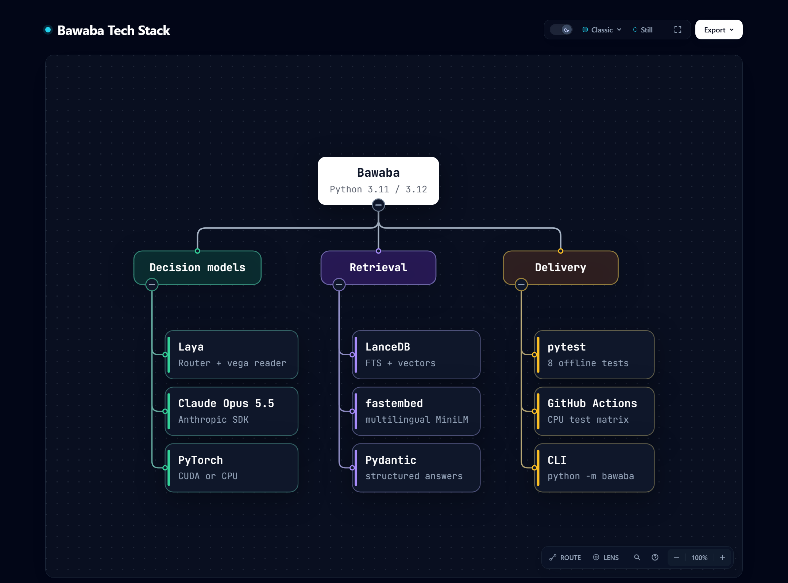

# Bawaba — a bilingual service desk where a fast model decides what the LLM may answer

[](https://github.com/attahussain/bawaba/actions/workflows/ci.yml)


*Bawaba (بوابة) means "gateway".* A tenant service desk for a residential building in Dubai that answers
in **English and Arabic**. A small local decision model, [**Laya**](https://github.com/NandhaKishorM/laya),
makes the routing decisions in tens of milliseconds: how urgent is this, what is it about, did search
find real evidence, is a passage trying to inject instructions. **Claude** writes the answers and settles
the decisions Laya is unsure about. Emergencies and unanswerable questions go to a person without any
LLM call.

> The knowledge base, the 240 tenant messages and the evaluation questions are fictional or synthetic.

## Results

32 end-to-end questions (16 English, 16 Arabic), Claude Opus 5.5, Laya on an RTX 4070 laptop GPU:

| Configuration | Correct action (EN / AR) | Facts in answers | Injection-safe | Avg time | Cost |
|---|---|---|---|---|---|
| Laya only, zero-shot | 0.72 (0.76 / 0.67) | 1.00 | 1.00 | 2.2 s | USD 0.09 |
| **Laya + Claude cascade (shipped)** | **0.88 (0.94 / 0.80)** | **1.00** | **1.00** | **2.9 s** | **USD 0.16** |
| Claude makes every decision | 1.00 (1.00 / 1.00) | 1.00 | 1.00 | 19.5 s | USD 1.10 |

The shipped design is **7x cheaper and 6.7x faster** than having Claude make every decision. All four
of its mistakes were safe ones: the question went to a person instead of being answered.

What the component evaluations found (details in [docs/evaluation.md](docs/evaluation.md)):

- **Zero-shot Laya is weak in Arabic.** On 120 held-out messages it missed more than half of the Arabic
  emergencies (recall 0.47) and classified Arabic intent at 0.30.
- **Fitting fixes part of it, cheaply.** Heads fitted on 120 labelled messages in under 30 seconds,
  without changing model weights, raised Arabic urgency accuracy from 0.43 to 0.75.
- **A cascade buys the rest.** Laya decides when confident, Claude when not: at the shipped threshold
  Claude sees 53% of messages, urgency accuracy is 0.85 (Claude alone: 0.95), and cost and latency halve.
- **Not every fit helps.** A gate head fitted on 17 positive examples dropped Arabic recall to 0.14,
  so the shipped evidence gate stays zero-shot.

## How it works



```
message ─► triage (Laya, Claude when unsure) ─► emergency ─► escalate to the 24-hour team (no LLM)
                                               │
                               retrieve: BM25 + multilingual vectors over EN/AR policies
                                               │
                     evidence gate (Laya): relevant? contains the answer? injected instructions?
                                               │
                                  nothing passes ─► hand off to a person (no LLM)
                                               │
                         Claude answers from the passed passages, in the tenant's language
```

| Stage | Engine | Notes |
|---|---|---|
| Triage | Laya reader (vega, 0.8B) with fitted heads; Claude below confidence 0.5 | `choice` questions for intent (5) and urgency (3) |
| Retrieval | LanceDB: BM25 + `paraphrase-multilingual-MiniLM-L12-v2`, reciprocal rank fusion | English and Arabic sections of each policy |
| Evidence gate | Laya Router (English / multilingual encoders), zero-shot | `noul` questions; injected sentences removed, clean ones kept |
| Answer | Claude, structured output with citations | Can still declare a question unanswerable |

Every decision is a typed Laya question, and `ClaudeDecider` answers the same questions, so each
stage can be switched between engines and compared on identical data. Design reasoning and limitations:
[docs/design.md](docs/design.md).

## Features



## Tech stack



<sub>Interactive versions (zoom, route tracing, light/dark): download and open
[architecture](docs/diagrams/architecture.html), [features](docs/diagrams/features.html),
[tech stack](docs/diagrams/tech-stack.html). Generated with [Archify](https://github.com/tt-a1i/archify)
from the JSON specs in `docs/diagrams/`.</sub>

## Quick start

```bash
python -m venv .venv && source .venv/bin/activate      # Windows: .venv\Scripts\activate
# NVIDIA GPU: install a CUDA build of torch first, e.g.
#   pip install torch --index-url https://download.pytorch.org/whl/cu126
pip install -e ".[dev]"
export ANTHROPIC_API_KEY=sk-ant-...                    # Windows: set ANTHROPIC_API_KEY=...

python -m bawaba "The AC stopped working and it is 45 degrees"
python -m bawaba "كيف أسترد مبلغ التأمين عند إخلاء الشقة؟"
python -m bawaba                                       # interactive
```

Laya downloads its checkpoints on first use. Offline, with no models and no API key:

```bash
BAWABA_PROVIDER=mock BAWABA_TRIAGE=keyword BAWABA_GATE=keyword BAWABA_EMBEDDER=hash python -m bawaba "Can I pay rent in cash?"
```

### Configuration

| Variable | Default | Meaning |
|---|---|---|
| `BAWABA_TRIAGE` | `cascade` | `cascade`, `laya` (zero-shot), `laya-fitted`, `claude` or `keyword` (tests) |
| `BAWABA_GATE` | `laya` | `laya`, `claude` or `keyword` |
| `BAWABA_CASCADE_THRESHOLD` | `0.5` | Below this Laya confidence, triage asks Claude |
| `BAWABA_HEADS` | `data/heads` | Fitted triage heads (written by `evals/triage_eval.py`) |
| `BAWABA_PROVIDER` | `claude` | Answer writer: `claude` or `mock` |
| `BAWABA_MODEL` / `BAWABA_EFFORT` | `claude-opus-5-5` / `low` | Claude model and effort |
| `BAWABA_EMBEDDER` | `fastembed` | `fastembed` (multilingual MiniLM) or `hash` (tests) |
| `BAWABA_MIN_RELEVANT` / `BAWABA_MIN_ANSWERS` / `BAWABA_MAX_INJECTION` | `0.5` / `0.5` / `0.7` | Gate thresholds |

## Tests and evaluation

```bash
pytest                                   # 8 offline tests: paths, gate, injection, cascade, data split
python evals/triage_eval.py              # triage: Laya zero-shot vs reader vs fitted heads (local)
python evals/cascade_eval.py             # Laya -> Claude threshold sweep
python evals/gate_eval.py                # evidence gate configurations
python evals/run_qa.py                   # end to end, shipped configuration
```

## Project layout

```
bawaba/
  pipeline.py    # Desk: triage -> retrieve -> gate -> answer / hand off / escalate
  deciders.py    # Laya, Claude and keyword decision engines; the cascade
  triage.py      # intent and urgency questions
  gate.py        # evidence questions, sentence-level injection removal
  kb.py          # bilingual section chunks, BM25 + multilingual vector search
  answer.py      # Claude writer (structured, cited) and offline mock
  config.py      # settings from environment variables
data/kb/         # fictional bilingual policies (+ one untrusted note with an injected instruction)
data/tickets.jsonl   # 240 synthetic labelled tenant messages
data/heads/      # Laya heads fitted on the training half
evals/           # generators, evaluation scripts, hand-labelled questions
docs/            # design decisions, evaluation, diagrams/ (PNG, interactive HTML, Archify specs)
```

## Why this project

Most LLM applications send every message to the LLM. In a service desk most messages need a fast
decision, not generated text: escalate it, route it, or admit the answer is not in the policies.
This project measures what a small local decision model can take over from an LLM, where it fails
(Arabic, zero-shot), and how much a cascade recovers, with every number reproducible from the repo.
