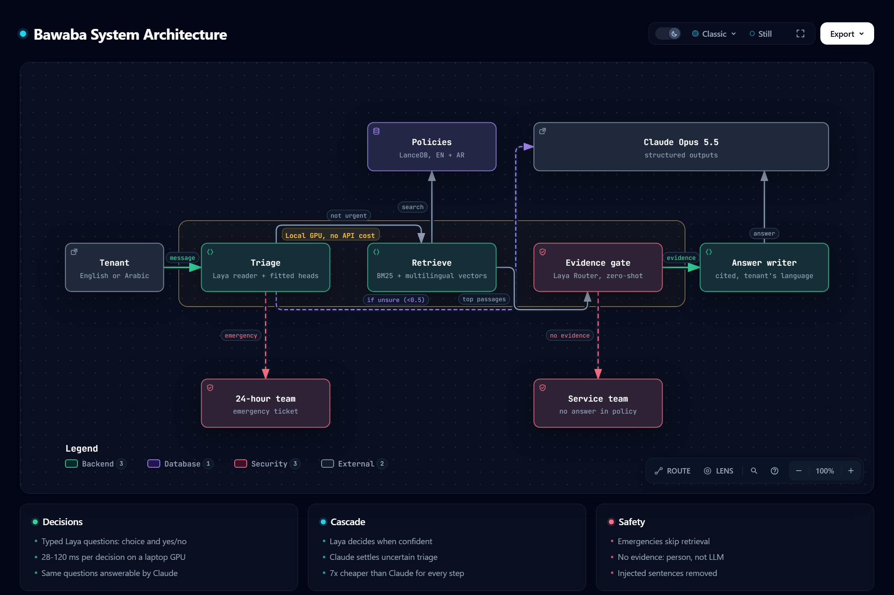

# Design decisions



## The idea

Most messages to a service desk do not need a large language model. Some need a person immediately
(a leak onto electrics), some cannot be answered from policy at all (a question nobody wrote down),
and only the rest should reach an LLM. Bawaba makes those decisions with **Laya**, a small typed
decision model that runs locally in tens of milliseconds, and calls **Claude** only to write answers
and to settle the decisions Laya is unsure about.

```
message ─► triage (intent, urgency) ─► emergency? ─► escalate to the 24-hour team (no LLM)
                                      │
                                      ▼
                    retrieve (BM25 + multilingual vectors, EN + AR policies)
                                      │
                    evidence gate: relevant? contains the answer? injected instructions?
                                      │
                       nothing passes ─► hand off to a person (no LLM)
                                      │
                    Claude writes the answer from the passed passages, in the tenant's language
```

## Decisions and trade-offs

**Typed questions, not prompts.** Every decision is a Laya question with a type: `choice` for intent
and urgency, `noul` (probability that a statement is true) for the evidence gate. The same questions
can be answered by Laya or by Claude (`ClaudeDecider`), which is what makes the comparisons in the
evaluation fair: identical inputs, identical labels, only the engine changes.

**A cascade for triage.** Zero-shot Laya was fast and weak in Arabic (urgency 0.43, emergency recall
0.47 on held-out messages). Heads fitted on 120 labelled messages lifted Arabic urgency to 0.75, still
well below Claude's 0.95. Rather than choose, the shipped triage asks Laya first and hands the message
to Claude when Laya's confidence in either answer is below 0.5. The threshold is a cost/quality dial,
measured in the evaluation; it is a setting, not a constant.

**Laya's own review route is not used for routing.** Laya's reader returns `route: review` when its
conformal prediction set is wide. With 30 calibration rows it sent about 95% of messages to review,
because (as its fit report states) no review line can certify 95% precision on so few rows. The
cascade uses the calibrated probabilities instead; collecting a few hundred labelled messages would
make the built-in route usable.

**The gate is tuned for recall.** Its main job is to notice that nothing relevant was found, so the
desk hands off without calling the LLM at all; passages it lets through are still checked by the
writer, which can declare the question unanswerable. Zero-shot Laya kept 86% of real evidence in both
languages with low precision; the head fitted on 17 positive pairs raised English precision but cut
Arabic recall to 14%, so the shipped gate is zero-shot.

**Emergencies skip retrieval.** An emergency gets an immediate escalation reply and a ticket; the
desk does not try to answer it from policy first.

**Injected text is removed sentence by sentence.** A contractor note mixes a real fact (cleaning days)
with an instruction to collect card numbers. Dropping the whole passage would lose the fact, so the
gate asks Laya about each sentence of a flagged passage and keeps the clean ones. The writer's system
prompt independently forbids asking for card numbers, passwords or ID documents.

**Answers in the tenant's language, from a bilingual knowledge base.** Each policy has English and
Arabic sections; retrieval uses a multilingual embedding model (`paraphrase-multilingual-MiniLM-L12-v2`)
plus BM25, so an Arabic question can match either language. Handoff and escalation replies are
fixed text in both languages, so no LLM is needed for them.

## Known limitations

- All data is synthetic or hand-written: the 240 triage messages were generated by Claude and the
  knowledge base and 32 evaluation questions are fictional. Accuracy on real tenant messages will differ.
- The evaluation sets are small (120 triage test messages, 90 gate pairs with 14 positives, 32
  end-to-end questions). Differences of a few points are within noise.
- Intent labels overlap (a deposit refund after leaving is both "move" and "payments"); even Claude
  reached 0.73 intent accuracy, which says as much about the labels as about the models.
- Laya's Arabic weaknesses are the main constraint; the cascade hides them at the cost of Claude calls.
- Laya's reader needs a GPU to stay under ~100 ms; on CPU expect several hundred milliseconds.
